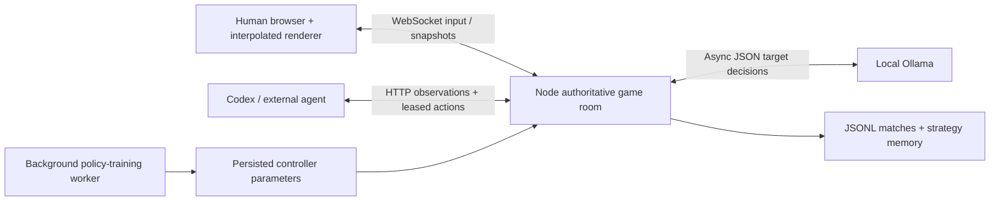

# SPACE / Invaders Reborn — Agent Arena 3.0

Play alone, fly alongside an AI wingman, connect Codex, or let a local Ollama model choose your ship's targets. The fast 2.1 gameplay is retained; this iteration adds a server-authoritative arena, recordings and learning.

## Play with agents

```sh
npm ci
npm start
```

Open **http://localhost:3000/arena**. You fly the green ship with **A/D or arrows** and hold **Space** to fire. The selected agent flies the violet ship, with its own lives, weapons and shields. Both share the score. Touch controls are available on phones.

Choose a wingman provider and Apply:

| Provider | Behavior |
| --- | --- |
| Local pilot | Built-in reactive rules; no model |
| Ollama | Local model chooses targets/fire; a fast reflex layer handles steering/dodging between decisions |
| Learned pilot | Reward-optimized controller from training |
| External Codex / agent | An agent connects through the local HTTP protocol |
| No autopilot | Wingman stays idle |

Pause affects the shared mission. Leaving or unfocusing the page releases/neutralizes human input; agents can continue playing without an open browser. There is one shared arena per server instance. A second browser can watch but cannot steal an occupied human ship. Node 20+ is required for the server.

### Ollama on your computer

With Ollama installed and running:

```sh
ollama pull qwen2.5:0.5b
npm start
```

Select **Ollama**, choose the installed model name and Apply. `qwen2.5:0.5b` is a small CPU-friendly starting model, not a strong game-playing model; larger installed models can be selected in the same field. The server uses `http://127.0.0.1:11434` by default. Override `OLLAMA_BASE_URL` and `OLLAMA_MODEL` through process environment if needed. First model load can be slower than later decisions. `OLLAMA_TIMEOUT_MS` sets the decision timeout (default 12000 ms). Errors/timeouts and local fallback are shown explicitly; inference never blocks game ticks.

### Docker: game + Ollama

```sh
docker compose up --build -d
docker compose exec -e OLLAMA_HOST=http://127.0.0.1:11434 ollama ollama pull qwen2.5:0.5b
```

Open **http://localhost:3000/arena** and select Ollama. The default Compose setup runs CPU Ollama; it does not assume a GPU driver. Model files and arena data use named volumes and survive container restarts. `OLLAMA_MODEL` chooses a different installed model; `PORT` changes the published local port. Stop with `docker compose down` (without `-v` to keep learning/model data). Game image runs as a non-root user and includes a health check. Model downloads can be several hundred MB or more, depending on the selected model.

## Connect Codex

```sh
npm run agent -- start --mode coop
npm run agent -- claim --role wingman --name Codex
npm run agent -- observe
npm run agent -- act --action '{"targetX":650,"fire":true,"dodge":true}' --duration 1500
```

An agent reads the observation, chooses another action, and repeats. The lease keeps it separate from the human ship. The current interactive Codex can use the CLI/JavaScript client directly through its tools; no OpenAI API key is required. An unattended agent must run separately; this chat does not continue in the background after a turn ends.

For slower, thoughtful Codex decisions, there is **paused solo stepping**: observe, choose an action, advance a fixed number of game frames, observe again. It cannot be used to pause/advance a human co-op session. See [the complete agent protocol](docs/AGENT_PROTOCOL.md) for CLI, HTTP and WebSocket examples.

## Learning and recordings

Open **Learning and recordings → Train local pilot**, wait for the reported champion reward, then select **Learned pilot** and Apply. For long-term training, run `npm run train -- --minutes 60` (or `--forever`) from a terminal. Every run continues from the saved checkpoint.

There are two separate learning mechanisms:

- **Ollama strategy memory:** after a match, reflection updates a short persisted strategy used in future prompts. This does not change the language model's weights.
- **Local policy optimization:** accelerated game episodes on fresh seeds optimize actual controller parameters against rewards. A new policy replaces the saved champion only by beating it on a fixed benchmark of unseen games. Training is checkpointed in `.data/training/` and runs in a worker while the live arena continues.

Completed/restarted matches produce per-ship rewards, a summary and a downloadable JSONL trace of actions, game events and observations. Data is in ignored `.data/` (or the Docker volume). The last 100 completed matches are retained; large recordings mark omitted trace lines. Read [learning details and reward definitions](docs/LEARNING.md).

## Offline game remains available

Download [`playable/space-invaders.html`](playable/space-invaders.html) and open the downloaded file directly. This includes the local human/AI/co-op game without a server, network or install. Network agents, Ollama, training and persistent match recordings require the arena server. Opening the unbundled development `index.html` requires HTTP.

```sh
npm run build
npm run static
```

The static build is in `dist/`; the portable output is `dist/space-invaders.html`. Copy that output into `playable/space-invaders.html` before committing a new portable edition.

## Validate

```sh
npm test
npm run test:server
npm run build
```

Optional Python Playwright/Chromium browser checks:

```sh
python test/browser-smoke.py
python test/browser-smoke.py --webgl
# With npm start running:
python test/browser-arena.py
```

`test/server.test.mjs` exercises real HTTP and WebSocket connections, ship ownership/lease expiry, recordings, paused stepping, provider timeout behavior, learning persistence, and worker responsiveness. Its Ollama protocol tests use a deterministic local test server; they do not claim to train a language model. Live Ollama and Docker validation results are described in the PR.

`python test/full-invasion.py . --soak` retains a full invasion and a 144-enemy/256-shot/1,000-particle render stress scene. Physics remains fixed at 120 Hz; GPU batching, software-GPU fallback, adaptive visual quality and collision bins retain the prior performance work. Sector-1 enemy speed stays 96 world px/s regardless of survivor count.

## Architecture



- `src/engine.js`: shared deterministic simulation; `loop.js`, `collision-grid.js`, `pilot.js` retain the game core.
- `src/renderer.js`, `webgl-renderer.js`, `canvas-renderer.js`, `quality.js`: GPU/Canvas rendering and adaptive effects.
- `src/online.js`: network transport and display interpolation; offline play stays local.
- `server/`: HTTP/WebSocket arena, controller leases, Ollama adapter, recordings and training worker.
- `agents/`: external control client/CLI, parameterized policy and reward-driven trainer.
- `legacy/angular-dart/`: original 2014 Dart project, preserved intact.

The server is designed for a local machine: it binds 127.0.0.1, validates browser origin/host, keeps tokens out of snapshots/records and serves only public game files. Docker publishes only on local loopback. Changing `BIND_HOST`/`ARENA_HOST` is an explicit deployment configuration; this iteration does not add Internet accounts or hosted multiplayer authentication.
